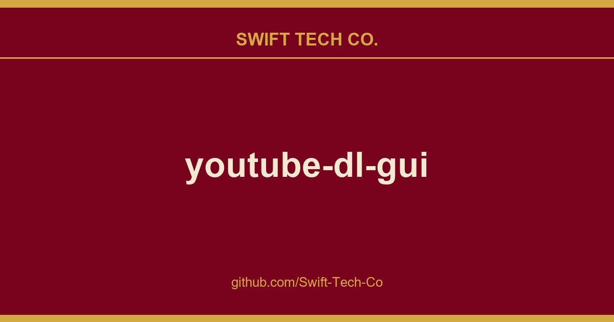

# youtube-dl-gui

## What This Is

A practical reference entry for product and engineering: the youtube-dl-gui notes, examples and fixes we reach for repeatedly. Kept current as part of the wider Swift Tech Co. engineering library.

## Images

## Screenshots

## Requirements
* Python 2.7.3+
* wxPython 3
* TwoDict
* GNU gettext (to build the package)
* FFmpeg (optional, to post process video files)

## Downloads
* Source (.zip)
* Source (.tar.gz)
* PyPi
* Ubuntu PPA
* Arch AUR
* Slackware SlackBuild
* openSUSE
* Windows Installer
* Windows Portable

## Installation

### Install From Source
1. Download & extract the source
2. Change directory into *youtube-dl-gui-0.4*
3. Run `python setup.py install`

### Install PyPi
1. Run `pip install youtube-dlg`

### Install Windows Installer
1. Download & extract the Windows installer
2. Run the `setup.exe` file

## Contributing
* **Add support for new language:** See [localization howto](docs/localization_howto.md)
* **Report a bug:** See issues

## License
The [Public Domain License](LICENSE)

## Frequently Asked Questions
See [FAQs](docs/faqs.md) file

## Thanks

---

## Swift Tech Co.

Built and maintained by Swift Tech Co.

AI Automation | FinTech Platforms | Custom Software and Mobile Apps | SaaS Platforms | Cloud Infrastructure | Cybersecurity | SEO and Marketing | API Integration

**Join our community on Telegram:** [t.me/+Qt_eFvkb2rliMzNh](https://t.me/+Qt_eFvkb2rliMzNh)

Home | Services | Careers | Referral Program | Influencers | About | Contact

**Connect**

- Website: swifttechco.com
- LinkedIn: [linkedin.com/in/stephenoladoke](https://www.linkedin.com/in/stephenoladoke/)
- LinkedIn (Company): [linkedin.com/company/swift-tech-co](https://www.linkedin.com/company/swift-tech-co)
- X: [@MrOladoke](https://x.com/MrOladoke)
- Instagram: [@mr.oladoke](https://www.instagram.com/mr.oladoke/)
- Instagram (Company): [@swifttechco](https://www.instagram.com/swifttechco/)
- Organization: [github.com/Swift-Tech-Co](https://github.com/Swift-Tech-Co)

## Sources

Compiled and maintained from upstream [MrS0m30n3/youtube-dl-gui](https://github.com/MrS0m30n3/youtube-dl-gui) under permissive open-source license.

---

Maintained by [Swift Tech Co.](https://github.com/Swift-Tech-Co) - [Telegram](https://t.me/+Qt_eFvkb2rliMzNh)